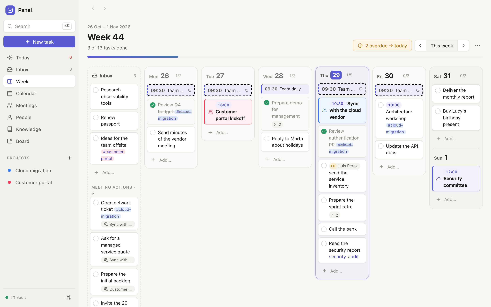
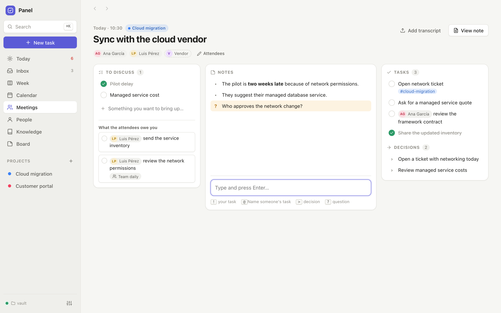
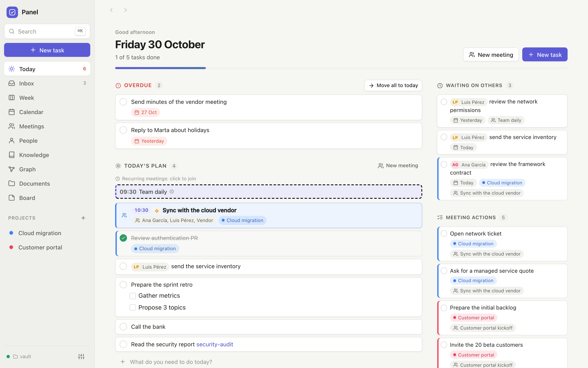
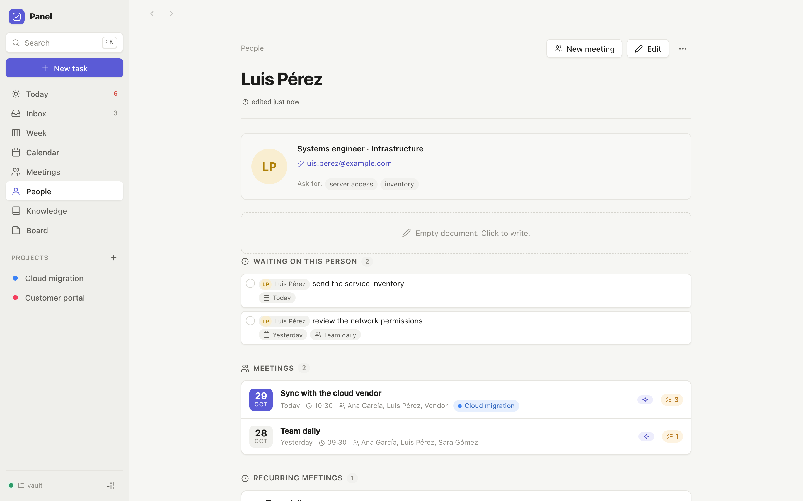
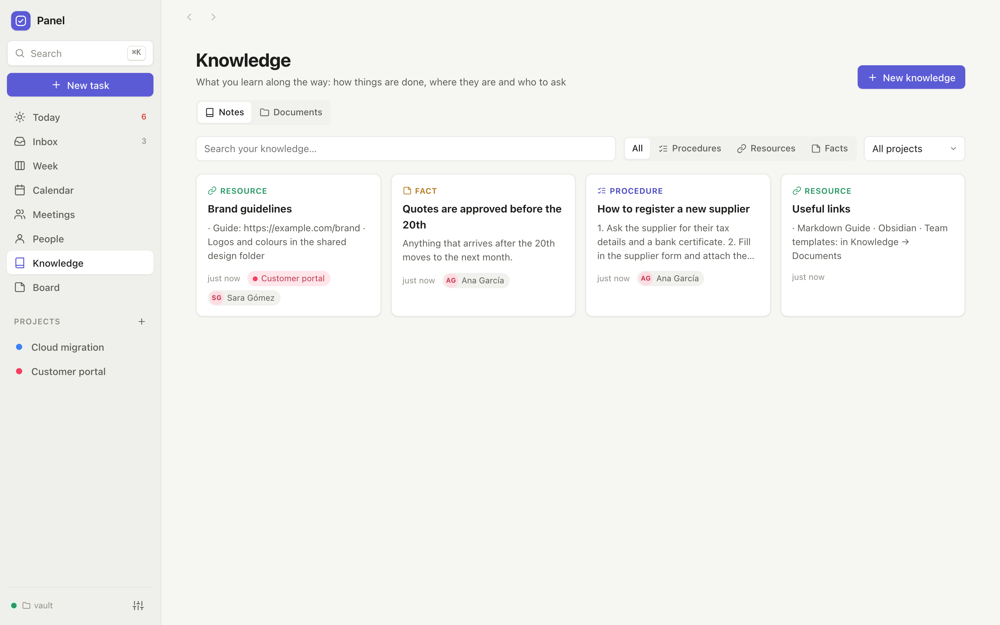
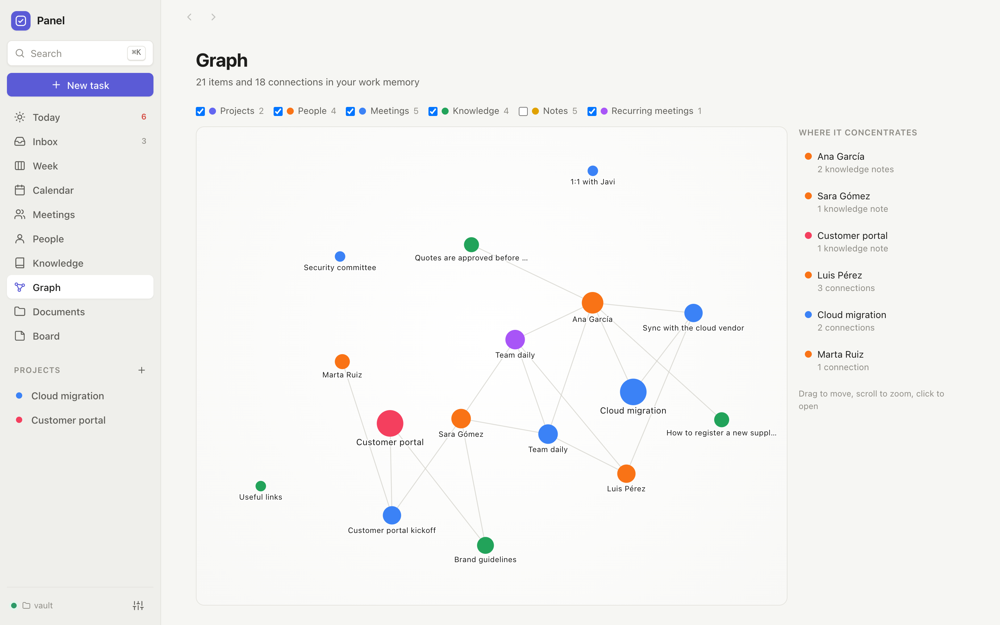

<div align="center">


# Panel

**Your work memory: your week, meetings, people and what you learn along the way — in Markdown that belongs to you,
with an AI that does the paperwork.**

No accounts. No cloud you have to trust. No admin rights.<br>
Windows, macOS and Linux.

[**Download for Windows**](https://github.com/jcordon5/panel/releases/latest/download/Panel-Windows.zip) ·
[macOS / Linux](#get-started) ·
[Español](README.es.md)



</div>

---

## The problem

Whole days going from meeting to meeting. The next day, the free slot goes into re-reading notes, scrolling chats for what was said,
rebuilding the task list… *tasks to create tasks*. And things still slip: who said they would send what, how that access was requested,
where that document was.

Panel is built so you can **be in the meeting** and then **do the work**, not organise it.

## How it works

1. **Plan your week** on a board: tasks and meetings in the order they happen.
2. **Take notes in the meeting note**: the whole screen is the note, with a button per section that stays on top and what's still
   open folded beside it, so it works on half a laptop screen next to the call. Plain Markdown below: `- [ ]` a task, `@Ana …` something you are
   waiting on from Ana. Is there a transcript? Drop it on top.
3. **Your AI processes it** (Claude or another agent, with the included [skill](skills/panel-vault)): "process my meetings" and it
   writes the summary, adds the tasks and decisions you missed, updates people's cards and keeps as knowledge what is worth
   remembering. The sources it used are deleted: no junk piles up.
4. **Talk to it like a colleague**: "remind me to ask for the quote on project Alpha", "log that we closed the migration" (it finds the
   related task and closes it, or records it as done), "I learned that quotes are approved before the 20th", "Ana handles invoices",
   "prepare the next daily" (it looks at the last one, what's pending on each side and what you've done since, and fills in "To discuss").
5. **Ask your memory**: "how do we register a new supplier?", "what does Luis owe me?", "where's the report template?". The answer
   comes from your notes and documents, with its source.

Everything is plain `.md` files in a folder of yours. You can read them, Panel shows them with structure, and your AI reads and edits them.

## What you get

<table>
<tr>
<td></td>
<td></td>
</tr>
<tr>
<td></td>
<td></td>
</tr>
<tr>
<td colspan="2"></td>
</tr>
</table>

- **Week and day plan** — one column per day plus the inbox; drag tasks and meetings around; bring overdue work to today in one click.
- **Recurring meetings** — a daily, a fortnightly sync, the first Monday of the month… with their usual attendees. Each session shows up
  on its day and its note is created when you join, with whatever was left to discuss last time.
- **Meetings** — their page shows time, attendees (people or whole teams) and attachments; while you write, only the note, a button
  per section to jump there and the context folded away (what's still open from the previous session, what the attendees owe you). Today and the
  week mark which meetings haven't happened yet and which still need processing.
- **Projects with a code** — give a project a short code and anything mentioning it (or `#code`) belongs to it; its tasks show its
  colour everywhere.
- **Graph** — a map of your work memory: projects, people, meetings and knowledge, and where most of it concentrates.
- **People** — cards with role, teams (one or several) and *what to go to them for*; each shows their meetings and what they owe you. Panel lists who
  appears in your meetings without a card and creates it in one click. Attendee picker with autocomplete.
- **Knowledge** — small notes of *procedures* (how something is done), *resources* (where something is) and *facts* (worth
  remembering), linked to projects and people.
- **Documents outside the vault** — point Panel to the folders with your templates, guides or documentation (e.g. in OneDrive): it lists
  them in *Documents*, finds them in search (<kbd>Ctrl</kbd>/<kbd>⌘</kbd>+<kbd>K</kbd>) and opens them with their app, and your AI knows
  they exist. Nothing is copied.
- **For your AI** — drop or paste transcripts (.vtt, .docx), emails (.eml, or .msg dragged out of Outlook) or chats; Today shows what is
  waiting to be processed.
- **Waiting on others** — any task starting with `@Name`; it shows in Today, on the person's card and in their meetings.
- **No syntax to learn** — a task's project, person, tags and time can be picked in a dialog; if you prefer typing
  `09:30 @Ana send the quote #project`, that works too.
- **An editor like Obsidian's** — formatted as you type; the Markdown only shows where the cursor is. Source and reading modes too.
- **Calendar** — your Outlook/Google/iCloud meetings show up on their own; one click creates the note.
- **Projects, a notes board, search everything** (<kbd>Ctrl</kbd>/<kbd>⌘</kbd>+<kbd>K</kbd>), **undo anything**, keyboard shortcuts,
  light/dark, English/Spanish.
- **Encrypted backups** of the whole vault with your password, also automatic to a cloud folder.

## Why this way

**Your data outlives the app.** It's all Markdown in a folder you choose. No database, no proprietary format: open it with any editor,
Obsidian, VS Code or Git. If Panel disappeared tomorrow you would lose nothing.

**The AI works on what you control.** Panel doesn't connect to your email or read your chats on its own: you decide what to hand it,
and your AI agent (the one you already use, with your account) distils it into the vault. Nothing leaves your computer except what you
ask your AI to do.

**Private by design.** No servers, accounts or analytics. A small program that only listens on your own computer.

**Works on a work laptop.** No admin install, no extensions, no access to other applications. Put the vault in your company OneDrive
and it syncs like any other document.

**Simple on purpose.** Week, meetings, people, knowledge and projects. No databases to design, no plugins to configure.

## Get started

- **Windows** — [download `Panel-Windows.zip`](https://github.com/jcordon5/panel/releases/latest/download/Panel-Windows.zip), unzip it and
  double-click **`panel.bat`**. Python is included: nothing else to install, no admin rights.
- **macOS / Linux** — [download `panel.zip`](https://github.com/jcordon5/panel/releases/latest/download/panel.zip), unzip and double-click
  `panel.command` (macOS; the first time, right-click → *Open*) or run `./panel.sh`. Needs Python 3.7+. Or in one line:
  `curl -fsSL https://raw.githubusercontent.com/jcordon5/panel/main/install.sh | sh`

Panel opens in your browser at `http://127.0.0.1:8765`. `python3 server.py --demo` starts it with sample data.

**Connect your AI**: copy [`skills/panel-vault`](skills/panel-vault) to `~/.claude/skills/` (Claude Code, the VS Code extension too) or add
it as a skill in the Claude app; point other agents to `skills/panel-vault/SKILL.md`. Then: "process my meetings".

## Your AI and your routines

The skill teaches your agent the vault format and gives it a script (Python standard library only) to do everything the way the app
does: see what's pending, read a meeting with its context, write the summary, create people cards and knowledge notes, plan and move
tasks, search everything.

The vault has a `routines.md` with your routines in plain words: *when I say "good morning", process what's pending and give me the
day*. You edit it; your AI follows it.

## Your data

- **Sync**: put the vault folder in OneDrive, Dropbox, iCloud or Syncthing.
- **Export**: *Settings → Vault → Export vault (.zip)*.
- **Encrypted backups**: *Settings → Backups* makes one file with the whole vault, encrypted with your password (AES-256-GCM, key from
  PBKDF2-SHA256 with 600,000 iterations). Panel can make one a day into a folder you choose (a OneDrive one, for instance). Restoring asks
  for the password and puts replaced files in `.trash`, or gives you a `.zip`. If the computer remembers the password, it keeps a key that
  can only *encrypt*: nobody with access to that computer can open the backups.
- **Safety nets**: deletes go to `.trash` inside the vault; a backup is made before every update.
- **Updates**: Panel checks GitHub when it starts and updates with one click. Only the app code is replaced; your vault and settings are
  never touched. **Older vaults keep working as they are**: everything new is optional and your AI can migrate your notes when you like.

## Calendar

*Settings → Calendar.* A calendar subscription link (**.ics**: Outlook on the web, Google Calendar, iCloud, Nextcloud…), refreshed
automatically, or **Outlook desktop** on Windows for companies that don't allow publishing calendars. Meetings appear in Today, Week and
Calendar; one click creates the note. Calendars are only read.

## The vault

```
vault/
├── README.md                     how it is organised (for people and AIs)
├── routines.md                   your routines for the AI
├── inbox.md                      tasks without a date
├── weeks/2026-W44.md             one file per week, one section per day (that day's plan, in order)
├── meetings/2026-10-29-….md      meetings (projects/<p>/meetings/ for a project's)
├── series/<name>.md              recurring meetings
├── people/<name>.md              people
├── knowledge/<title>.md          knowledge: procedures, resources, facts
├── projects/<project>/README.md  projects
├── notes/*.md                    notes (the Board)
├── sources/*.md                  what you leave for your AI (deleted once processed)
└── templates/, assets/           templates and images
```

```markdown
## Thursday · 2026-10-29

- [ ] 09:00 Review the report #project-alpha
- [[2026-10-29-alpha-sync]]            ← the meeting, where it happens
- [ ] @Ana send the quote               ← waiting on Ana
- [[2026-10-28-alpha-sync#^k3x9pa]]    ← a task of another meeting, planned for today
```

The full format of every file is in [`skills/panel-vault/references/format.md`](skills/panel-vault/references/format.md). Compatible
with Obsidian.

**Coming from Panel v1 (`boveda/`)?** Put your `boveda` folder next to `server.py` before the first start and Panel offers to migrate it
(the original is never modified), or run `python3 tools/migrate_v1.py path/to/boveda path/to/vault es`.

## Privacy & security

- No servers, accounts, analytics or tracking.
- The server only listens on `127.0.0.1`, rejects requests from other websites and can only touch files inside the vault.
- Rendered Markdown is sanitised (no raw HTML, no `javascript:` links) and a strict Content Security Policy is applied.
- What you drop for your AI goes through a filter that hides obvious passwords and tokens, and is deleted once processed.
- The only outbound requests are the ones you configure: your calendars and the update check.

## Development

No build step and no dependencies: plain HTML/CSS/ES modules in `app/`, `server.py` (standard library only), and
[marked](https://github.com/markedjs/marked) and [CodeMirror 6](https://codemirror.net) vendored (`tools/vendor/build-codemirror.sh`
rebuilds CodeMirror; only needed to update it).

```bash
python3 server.py --demo   # with sample data
npm test                   # node --test tests/*.test.js && python3 -m unittest discover -s tests
```

Contributions are welcome — especially translations (`app/js/strings.js`).

## License

[MIT](LICENSE) — free to use, change and share.
